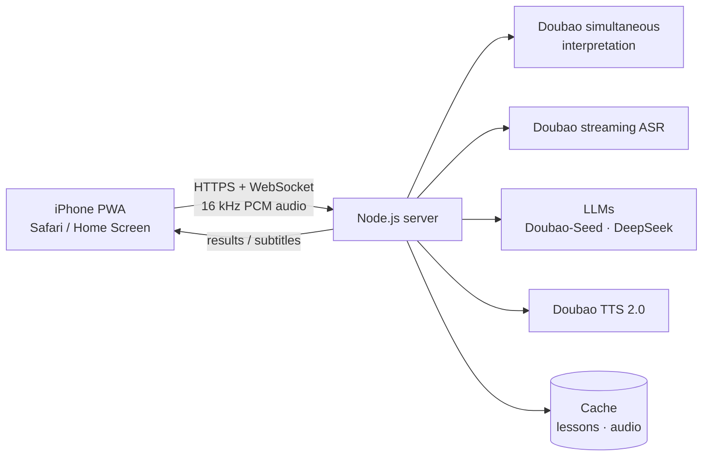

<div align="center">


# MISHU Translator

**A real-time Chinese ⇄ English interpreter and AI Chinese tutor for iPhone**

[](https://nodejs.org)
[](#tech-stack)
[](#getting-started)
[](#tech-stack)
[](LICENSE)

<sub>Tutor avatar generated with the Doubao Seedream AI image model.</sub>

</div>

---

## Overview

MISHU Translator is built for everyday conversations in China. Hold up the phone and both people get
live subtitles and a natural voice in their own language, with no app store install. The same app includes an
AI Chinese tutor that teaches the full **New HSK 3.0** vocabulary through lessons, speaking practice and stories.

The iPhone runs a **Progressive Web App**. A lightweight **Node.js server** keeps all API keys private and
streams audio to the Volcengine / Doubao AI models over WebSockets.

## Contents

- [Features](#features)
- [Architecture](#architecture)
- [Tech stack](#tech-stack)
- [Getting started](#getting-started)
- [Configuration](#configuration)
- [Project structure](#project-structure)
- [Roadmap](#roadmap)
- [Built with AI](#built-with-ai)
- [License](#license)

## Features

### 🗣️ Live interpreter

| Feature | Description |
|---|---|
| **Listen mode** | The other person speaks Chinese, and you get streaming English subtitles plus voice |
| **Hold to speak** | Your English is shown large in Chinese and spoken aloud for the other person |
| **Two-way auto mode** | One hands-free session detects each sentence's language and translates it the other way |
| **Multiple engines** | Simultaneous interpretation model, or streaming ASR + LLM translation (Doubao / DeepSeek) |
| **Audio modes** | Earphones, loudspeaker (the mic pauses during playback so it doesn't hear itself), or text only |
| **Context hints** | A topic and custom names/terms improve accuracy |

### 📚 AI Chinese tutor (New HSK 3.0, levels 1–9, ~11,000 words)

| Feature | Description |
|---|---|
| **Word lessons** | 10 AI-written example sentences per word (medium → hardest) with situation, emotion and usage tips; cached and shared by all users |
| **Speaking practice** | "Video call" layout: the tutor speaks, you repeat, and pronunciation is scored live (80+ to pass) |
| **Learning journey** | A chapter path with progress, stars and unlockable chapter stories |
| **Review** | Spaced-repetition quizzes and AI-graded "your turn" tasks |
| **Story mode** | Adaptive listening stories (45 s → 6 min) with HSK-style questions, then repeat and retell |
| **Natural voice** | Doubao TTS 2.0 with a server-side audio cache, and a per-user cost counter |

## Architecture



- **Keys never reach the client:** the phone talks only to your own server, and access is controlled by per-user keys.
- **Low latency:** the mic is captured with an `AudioWorklet`, resampled to 16 kHz and streamed in small frames.
- **Cost-aware:** generated lessons and speech are cached once and reused by every user.

## Tech stack

| Layer | Technology |
|---|---|
| Client | Vanilla JavaScript PWA, Web Audio API, `AudioWorklet`, Speech Synthesis fallback |
| Server | Node.js 22 (ES modules), HTTPS, WebSocket (`ws`, the only dependency) |
| AI services | Volcengine Ark: Doubao interpretation, streaming ASR, Doubao-Seed & DeepSeek LLMs, TTS 2.0, Seedream |
| Protocols | Custom binary frame encoder/decoder for the Doubao speech APIs |
| Security | Self-managed CA and TLS certificates (required for iOS mic access), per-user access keys |
| Deployment | Ubuntu 24.04 VPS, systemd service |

## Getting started

### Prerequisites
- Node.js **22.9+**
- A Volcengine account with Ark and Doubao Speech enabled (or use the **Demo** engine without keys)

### Install and run

```bash
git clone https://github.com/MISHU-KHONDOKER/MISHU-Translator.git
cd MISHU-Translator
cp .env.example .env    # add your keys
npm install
npm run cert            # create a local CA + HTTPS certificate for this machine's IP
npm start
```

### Set up the iPhone
1. In **Safari**, open `http://<server-ip>:8080/`, then install and trust the certificate profile.
2. Open `https://<server-ip>:8443/` → **Share** → **Add to Home Screen**.

## Configuration

All settings live in `.env` (see [`.env.example`](.env.example)).

| Variable | Purpose |
|---|---|
| `ARK_API_KEY` | Volcengine Ark API key (LLMs) |
| `ARK_DOUBAO_MODEL`, `ARK_DEEPSEEK_MODEL`, `ARK_TUTOR_MODEL` | Model IDs for translation and tutor content |
| `SI_APP_ID`, `SI_ACCESS_TOKEN` | Doubao simultaneous interpretation |
| `SPEECH_API_KEY` *or* `SPEECH_APP_ID` + `SPEECH_ACCESS_TOKEN` | Doubao streaming speech recognition |
| `ASR_RESOURCE_ID` | ASR resource (e.g. `volc.seedasr.sauc.duration`) |
| `TTS_VOICE` | Doubao TTS voice for the tutor |
| `ACCESS_KEYS` | Comma-separated user keys (leave empty for open LAN use) |
| `HTTPS_PORT`, `HTTP_PORT` | Server ports (default 8443 / 8080) |

## Project structure

```
├── server/
│   ├── index.js        # HTTPS + WebSocket server, routing, access keys
│   ├── si.js           # simultaneous interpretation client
│   ├── asr.js, pb.js   # streaming ASR + binary protocol
│   ├── llm.js          # LLM translation
│   ├── tutor.js        # tutor API: lessons, scoring, stories, TTS cache
│   └── hsk3.json       # New HSK 3.0 word list
├── public/             # PWA: index.html, app.js, tutor.js, style.css, mic-worklet.js
├── scripts/make-cert.js
├── data/               # cached lessons and TTS audio
└── design/             # HTML design mockups
```

## Roadmap

- [x] Live interpreter with multiple engines and two-way auto mode
- [x] AI tutor: lessons, speaking practice, review, stories
- [x] Cloud deployment
- [ ] Warm-paper redesign for all tutor screens
- [ ] Real talking-avatar video with lip-sync
- [ ] Budget alerts and usage dashboard

## Built with AI

This project was designed and developed with the help of large language models.
Inside the app, **Doubao** models generate the lesson content, the tutor's voice and the avatar image.

## Credits

HSK 3.0 word list from [complete-hsk-vocabulary](https://github.com/drkameleon/complete-hsk-vocabulary) by drkameleon (MIT).

## License

Released under the [MIT License](LICENSE). © 2026 MISHU-KHONDOKER
